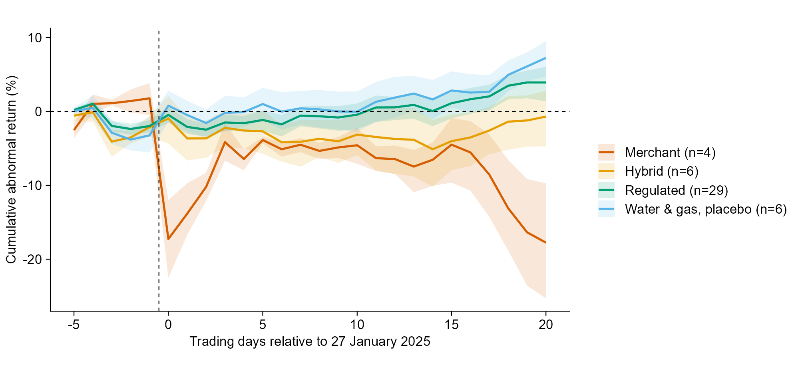
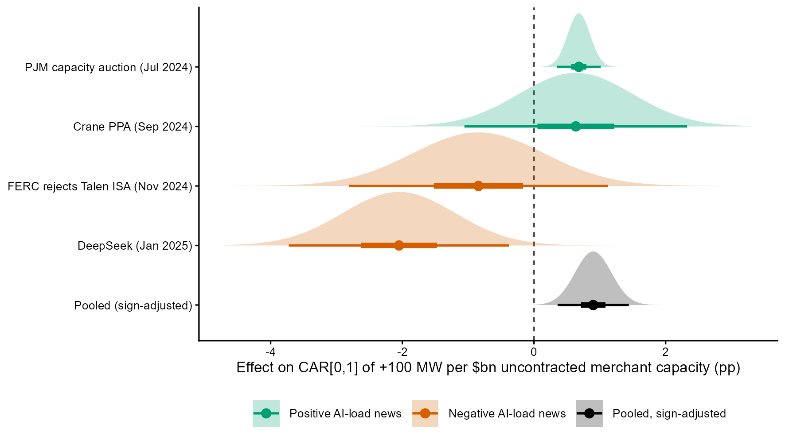
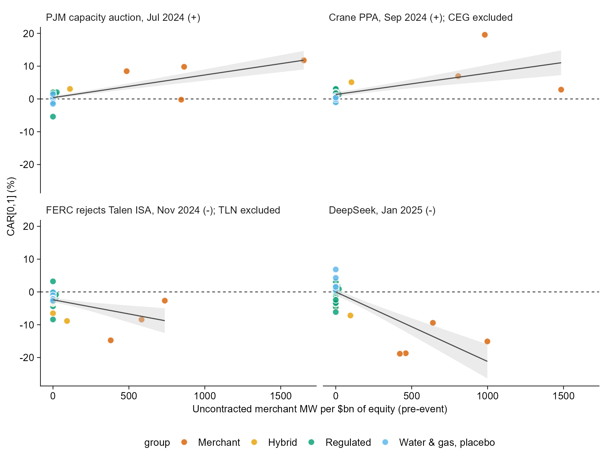

# Who Captures AI Load? Power-Sector Equity Returns and the DeepSeek Shock

An event study of how US power-sector stocks reacted on 27 January 2025, when DeepSeek's R1 model raised doubts about how much electricity AI would need. The study compares merchant generators, regulated utilities, and water and gas utilities (placebo).

> **Status:** pilot. Firm classification is frozen under a written rule ([`docs/classification_rule.md`](docs/classification_rule.md)). Contract evidence is partly verified. The stacked-event test was pre-specified before its returns were computed ([`docs/research_design.md`](docs/research_design.md), section 8c).

## Research question

When expectations about AI electricity demand move, whose value moves with them? If market-priced generators capture the value of expected AI load, other consumers pay for it through wholesale prices. Equity returns give an early, market-implied measure of that incidence.

Full design, hypotheses and preliminary results: [`docs/research_design.md`](docs/research_design.md)

## Preliminary result

On the event day, merchant generators earned an abnormal return of about −19% (equal-weighted portfolio, t = −8.75), 20.5 points below regulated electric utilities. Water and gas utilities rose 4.0%. Each additional 100 MW of uncontracted non-regulated capacity per $bn of equity value predicts a 2.6-point lower return. Firms whose non-regulated fleets are long-term contracted barely moved: AES fell 0.3%, while Talen, with similar capacity per dollar but no long-term contracts, fell 19.9%. Most of the merchant fall reversed within about three trading days.



## Good news and bad news move the same firms

The same exposure measure predicts returns on three earlier AI-electricity events, with the sign flipping between good and bad news: the July 2024 PJM capacity auction (+), the Constellation and Microsoft Crane PPA (+), and FERC's rejection of the Talen and Amazon agreement (−). Stacking all four events, the sign-adjusted slope is +0.90 percentage points per 100 MW/$bn (firm-clustered p = 0.001). It is larger than in all 2,000 placebo draws of four random non-event dates. Dropping DeepSeek leaves +0.68.





## Reproducing

Requires Python 3.10 or later, and R 4.3 or later with `tidyplots`, `ggdist`, `distributional`, `dplyr`, `readr` and `tidyr` for the figures.

```bash
pip install -r requirements.txt
python run_all.py
```

`run_all.py` runs five stages:
1. `code/01_download_prices.py` downloads prices and market caps from Yahoo Finance.
2. `code/02_build_exposure.py` builds exposure measures from EIA-860 2024, downloading about 21 MB from eia.gov.
3. `code/03_event_study.py` runs the DeepSeek event study.
4. `code/04_stacked_events.py` runs the stacked-event test.
5. `code/05_figures.R` draws the figures. If `Rscript` is not on PATH, set the `RSCRIPT` environment variable to its location. Tables go to `output/tables/` and the figure to `output/figures/`. Yahoo data can be revised over time, so a fresh download may differ slightly from the committed results. The download timestamp is recorded in `data/raw/download_meta.json`.

## Repository layout

```
.
├── run_all.py
├── code/
│   ├── config.py               # dates, windows, events
│   ├── 01_download_prices.py
│   ├── 02_build_exposure.py
│   ├── 03_event_study.py
│   ├── 04_stacked_events.py
│   ├── 05_figures.R            # tidyplots + ggdist
│   └── es_utils.py             # shared event-study helpers
├── data/
│   ├── classification/         # committed hand-coded inputs
│   │   ├── firms.csv           #   universe and sector type
│   │   ├── eia_name_map.csv    #   EIA owner names -> listed parent
│   │   ├── eia_overrides.csv   #   documented fixes for stale EIA names
│   │   └── contract_status.csv #   10-K contract evidence with sources
│   ├── raw/                    # downloads (not committed)
│   └── derived/                # exposure.csv (rebuilt by the code)
├── output/{tables,figures}/
├── docs/
│   ├── research_design.md
│   └── classification_rule.md  # written rule, amendments, what changed
└── report/
```

## Methods in brief

- Market-model abnormal returns.
- Three inference approaches that allow for a common event date: equal-weighted portfolio tests, Kolari and Pynnönen (2010) adjusted BMP tests, and a placebo-day distribution for the cross-sectional slope.
